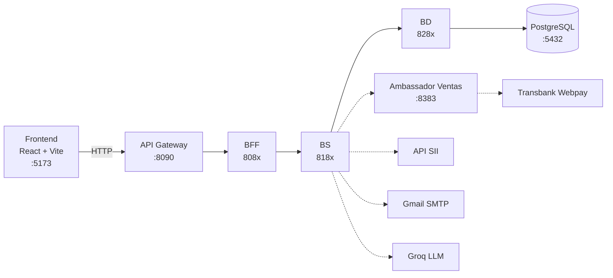

# LicitaWatch — Capstone APT122 · Duoc UC 2026

**LicitaWatch** es un marketplace B2B privado de licitaciones. Las empresas **licitadoras** publican sus necesidades de compra o servicio sin costo, y las **Pymes** postulan con su oferta. Cuando el licitador aprueba una postulación, la licitación queda adjudicada y se abre un chat privado entre ambas empresas para cerrar el negocio.

Equipo: **Pablo Báez · Gonzalo Palacios · Daniel Román**

---

## Contenido del repositorio

```
CAPSTONE-LICITAWATCH/
├─ Fase 1/        Evidencias de la fase 1 (definición del proyecto)
├─ Fase 2/        Evidencias de la fase 2 (desarrollo: Scrum, sprints, informe, presentaciones)
├─ Fase 3/        Evidencias de la fase 3
└─ LicitaWatch/   Código fuente de la plataforma (última versión)
```

---

## Qué hace la plataforma

| Rol | Qué puede hacer |
|---|---|
| **Licitador** | Publica licitaciones gratis, revisa postulaciones y las aprueba (adjudica) o rechaza; conversa con la Pyme adjudicada. |
| **Pyme** | Busca licitaciones, postula y conversa con el licitador cuando gana. Plan **Estándar** gratis (3 postulaciones al mes) o **Premium** $24.990/mes (7 postulaciones al mes, avisos por correo de licitaciones de su rubro, prioridad de visibilidad y el asistente **LicitAsist**). |
| **Administrador** | Gestiona usuarios y supervisa la plataforma. |

Funciones principales:
- Registro con **validación del RUT de la empresa en el SII** y verificación del correo electrónico.
- Inicio de sesión con **JWT** y permisos por rol.
- Publicación, búsqueda y postulación a licitaciones, con cupo mensual según el plan.
- Pago del plan Premium con **Webpay Plus de Transbank** (ambiente de integración).
- Notificaciones en la campana y por correo (por ejemplo, «Licitación de tu rubro» al publicarse una).
- Chat privado entre licitador y Pyme tras la adjudicación.
- **LicitAsist**: asistente con IA (Groq) para Pymes Premium.

---

## Tecnologías

| Capa | Tecnologías |
|---|---|
| Frontend | React 18, TypeScript, Vite 5 |
| Backend | Java 21, Spring Boot 3.3, Maven multi-módulo |
| Entrada al backend | Spring Cloud Gateway |
| Datos | PostgreSQL (5 bases, una por microservicio), Spring Data JPA / Hibernate |
| Seguridad | JWT (jjwt), contraseñas con BCrypt, clave interna entre capas |
| Servicios externos | Transbank Webpay Plus, Groq (LLM), Gmail SMTP, API del SII |

Todo corre de forma local (on-premise), **sin Docker**.

---

## Arquitectura

El backend está dividido en **microservicios por dominio**, y cada microservicio en **capas que corren como procesos separados, cada una con su propio puerto**:



- **API Gateway**: puerta única del backend. Enruta `/api/**` al BFF de cada dominio y aplica CORS.
- **BFF** (*Backend For Frontend*): valida el token JWT, el rol y el formato de los datos; no tiene lógica de negocio.
- **BS** (*Business Service*): reglas de negocio. Llama a su capa BD y a la BS de otros dominios por REST.
- **BD**: entidades JPA y repositorios. Es la **única capa conectada a PostgreSQL**.
- **Ambassador de Ventas**: único componente que se comunica con Transbank; la BS de Ventas nunca conoce las credenciales de la pasarela.

Las capas internas (`/bs/**`, `/bd/**`, `/ambassador/**`, `/internal/**`) exigen una clave interna y el gateway no las expone. Entre microservicios no hay llaves foráneas: las referencias (por ejemplo `usuarioId`) se validan por REST.

### Microservicios y puertos

| Microservicio | BFF | BS | BD | Base de datos | Responsabilidad |
|---|---|---|---|---|---|
| usuarios | 8081 | 8181 | 8281 | `licitawatch_usuarios` | Registro, login JWT, verificación de correo, perfil, administración, validación SII |
| licitaciones | 8082 | 8182 | 8282 | `licitawatch_licitaciones` | Licitaciones, postulaciones, adjudicación, aviso por rubro |
| ventas | 8083 | 8183 | 8283 | `licitawatch_ventas` | Planes, suscripciones, ventas y pagos (+ Ambassador **8383** → Transbank) |
| notificaciones | 8084 | 8184 | 8284 | `licitawatch_notificaciones` | Campana y envío de correos |
| chat | 8085 | 8185 | 8285 | `licitawatch_chat` | Conversación privada tras adjudicar |
| asistente | 8086 | 8186 | — | — | LicitAsist (Groq) |

Además: **API Gateway 8090** (el script de arranque lo levanta en 8090; el valor por defecto del código es 8080), **frontend 5173** y **PostgreSQL 5432**. En total son 19 procesos Java.

El modelo entidad-relación está en `LicitaWatch/docs/`.

---

## Cómo correrlo localmente

Todos los comandos se ejecutan dentro de la carpeta **`LicitaWatch/`**.

### 1. Requisitos

- **JDK 21** y **Maven 3.9+**
- **Node.js 20+**
- **PostgreSQL 16 o superior** (usuario `postgres`, puerto 5432)
- **Git**
- Conexión a internet para el pago con Webpay (ambiente de integración de Transbank)

### 2. Base de datos

Crea las 5 bases y sus tablas con los scripts de `db/` (desde una terminal o desde el Query Tool de pgAdmin):

```bash
psql -U postgres -f db/00_crear_bases.sql
psql -U postgres -d licitawatch_usuarios       -f db/01_usuarios.sql
psql -U postgres -d licitawatch_licitaciones   -f db/02_licitaciones.sql
psql -U postgres -d licitawatch_ventas         -f db/03_ventas.sql
psql -U postgres -d licitawatch_chat           -f db/04_chat.sql
psql -U postgres -d licitawatch_notificaciones -f db/05_notificaciones.sql
```

Al iniciar por primera vez, la aplicación carga los catálogos y crea la cuenta de administrador. Si las bases ya existían de antes, aplica las migraciones `db/migracion_*.sql` (detalle en `db/README.md`).

> Si la contraseña de tu usuario `postgres` no es `postgres`, defínela en la variable de entorno **`DB_PASS`** antes de levantar el backend.

### 3. Compilar el backend

```bash
mvn -DskipTests install
```

### 4. Levantar el backend

**Linux / macOS / Git Bash en Windows:**

```bash
./scripts/iniciar-backend.sh
```

Levanta las 19 aplicaciones en orden (BD → Ambassador → BS → BFF → Gateway) en aproximadamente un minuto. Los logs quedan en `logs/<módulo>.log`. Para detenerlas:

```bash
./scripts/detener-backend.sh
```

**Alternativa con IntelliJ IDEA:** abre el `pom.xml` de `LicitaWatch/` como proyecto y ejecuta cada clase `*Application` en este orden: las de capa **BD**, `VentasAmbassadorApplication`, las **BS**, las **BFF** y, por último, el **gateway** con la variable `PORT=8090`.

> **Windows:** si Java falla con *"Unable to establish loopback connection"*, es porque la carpeta temporal de tu usuario tiene espacios. Crea `C:\licitawatch-tmp` y agrega `-Djdk.net.unixdomain.tmpdir=C:\licitawatch-tmp` a las opciones de la JVM (variable `JAVA_OPTS` del script o *VM options* en IntelliJ).

Comprueba que el backend responde en http://localhost:8090/api/catalogos/rubros

### 5. Levantar el frontend

```bash
cd frontend
npm install
npm run dev
```

Abre **http://localhost:5173**. El archivo `frontend/.env` ya apunta al backend real:

```
VITE_USE_MOCK=false
VITE_API_URL=http://localhost:8090
```

Con `VITE_USE_MOCK=true` el frontend funciona **sin backend**, con datos simulados en el navegador: sirve para revisar las pantallas rápidamente.

### 6. Configuración opcional

| Qué | Cómo |
|---|---|
| **Envío real de correos** (verificación, recuperación, avisos) | Copia `correo.env.example` como `correo.env`, completa la cuenta Gmail y su contraseña de aplicación, y vuelve a ejecutar `iniciar-backend.sh`. Sin este archivo los correos solo se registran en `logs/ms-notificaciones-bs.log`. `correo.env` está en `.gitignore`. |
| **LicitAsist con IA** | Variable `GROQ_API_KEY`. Sin ella, el asistente responde con reglas locales. |
| **Puerto del gateway** | Variable `GATEWAY_PORT` del script (por defecto 8090). Si la cambias, ajusta `VITE_API_URL` en `frontend/.env`. |

---

## Datos para probar

**Administrador:** `admin@licitawatch.cl` / `Admin123!`

**RUT de empresa** (el SII funciona en modo de prueba: valida el dígito verificador y que sea un RUT de empresa, ≥ 50.000.000). Cada RUT se puede registrar una sola vez:

| Ficticios | Empresas conocidas (el sistema completa la razón social) |
|---|---|
| 76.086.428-5 · 76.111.111-6 · 76.222.333-3 · 77.123.456-9 | 90.749.000-9 Falabella · 61.704.000-K Codelco · 97.004.000-5 Banco de Chile |

**RUT de persona de contacto** (< 50.000.000): 11.111.111-1 · 12.345.678-5 · 15.678.234-3 · 18.765.432-7

**Tarjetas de prueba de Webpay** (cualquier fecha de expiración; en la autenticación del banco usa RUT `11.111.111-1` y clave `123`):

| Tarjeta | Número | CVV | Resultado |
|---|---|---|---|
| VISA | 4051 8856 0044 6623 | 123 | Aprobada |
| AMEX | 3700 0000 0002 032 | 1234 | Aprobada |
| MASTERCARD | 5186 0595 5959 0568 | 123 | Rechazada |
| Redcompra | 4051 8842 3993 7763 | — | Aprobada |

---

## Más documentación

- `LicitaWatch/README.md`: detalle técnico del backend, del flujo de pago con Transbank y del SII.
- `LicitaWatch/db/README.md`: creación de las bases y migraciones.
- `LicitaWatch/docs/`: modelo entidad-relación.
- `Fase 2/Evidencias proyecto/`: documentación Scrum (backlog, sprints, retrospectivas, informe y presentaciones).
